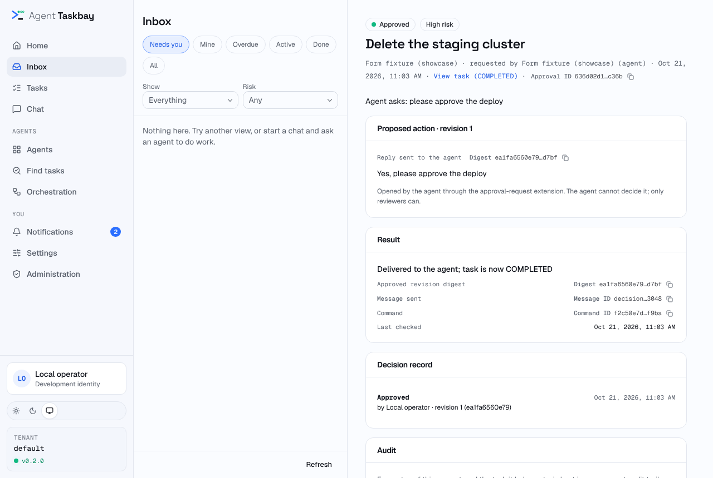
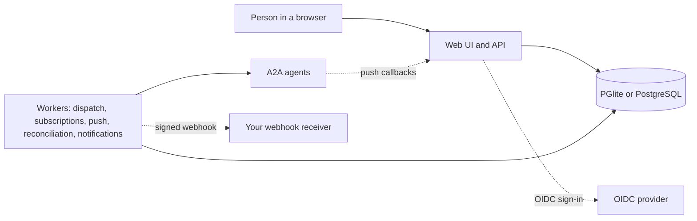

# Agent Taskbay

[](https://github.com/allsrc/agent-taskbay/actions/workflows/ci.yml)
[](https://www.npmjs.com/package/agent-taskbay)
[](./LICENSE)

**Agent Taskbay is the human operations console for A2A agent workflows.** Start long-running work with any compatible agent, keep
tracking it after you close the browser, and step in only when the agent needs input or approval, with an auditable record of who
decided what.

It works with any agent that publishes an [A2A](https://a2a-protocol.org) Agent Card. Agents can opt in to richer behavior (typed
forms, approval requests, skill-scoped access) through advertised extensions, and an optional AG-UI adapter lets AG-UI clients drive the
same durable tasks. Taskbay does not run your agents. It is the place where people start their work, answer them, approve what they
propose, and later show what happened.


Created and maintained by [Shashi Kanth G S](https://shashikanth.me), part of [Allsrc](https://allsrc.dev).

> **Status: pre-1.0 (`0.2.0`), published on npm as `agent-taskbay`.** Interfaces, HTTP routes and stored data shapes may change between
> minor versions. It has not been independently security-reviewed. See [Status and roadmap](docs/project/status-and-roadmap.md) for what
> works, what is partial and what is planned.

## The gap it fills

A2A gives agents a common way to accept a task, report progress, ask for input and return results. It describes how agents talk to each
other. It does not give a *person* a place to stand in that conversation.

Real agent work is long-running. A task can take minutes or days, and a browser tab cannot hold that. The tab closes, the connection
drops, a colleague needs to see the same task, or the agent stops to ask a question that nobody is watching.

Some steps also need a human decision before they happen: deleting an environment, sending a payment, merging a change. A decision is
only worth something if you can later show exactly what was approved, by whom, and that exactly that version was sent to the agent, once.

Agent Taskbay fills that gap. It keeps the record in its own database rather than in the browser, pulls a person back in only when the
agent needs them, and executes each approval against the exact revision that was reviewed, once.

## Try it

You need Node.js 22.19 or newer. No database server, no account and no `.env` file.

**1. Start the console.**

```bash
npx agent-taskbay
```

It starts at <http://127.0.0.1:3002> and opens your browser, signed in as a local administrator, with an embedded database in `~/.agent-taskbay`. It binds to this
machine only.

**2. In a second terminal, start the sample agents.** These are test fixtures, not real agents.

```bash
npx agent-taskbay demo-agent
```

It prints four Agent Card URLs on port 4010. You will use the `showcase` one.

**3. Connect the agent.** In the console, open **Agents** and choose **Add agent** (the sample-agent output calls this "Connect agent").
Paste:

```text
http://127.0.0.1:4010/showcase/card.json
```

Choose **Fetch Agent Card**, then **Continue**, then **Connect**. The agent page shows the card the console fetched. Connecting the other printed cards adds them to the same list.


**4. Give it work that needs you.** Open the agent, choose **Start chat**, and send:

```text
please approve the deploy
```

**5. Make the decision.** Open **Inbox**. Under **Needs you** there is a pending approval, "Delete the staging cluster", marked **High risk**.
Open it, review the proposed action, choose **Approve**, and confirm.


**What you should see:** the approval becomes `approved`, the exact content you reviewed is sent to the agent once, and the task moves to
completed. The approval page shows "Delivered to the agent; task is now" followed by the task state, and **Audit** lists every step.



Close the browser at any point and open it again: the state is in the database, not the tab.

The [quickstart](docs/quickstart.md) walks through each step, running from a git checkout, and what to check when a step fails.

## What you get

| Capability | In short |
| --- | --- |
| Agent catalog | Connect agents by Agent Card URL. Taskbay discovers their skills, interfaces and security schemes, and shows discovery errors and card signature status. |
| Durable tasks | Every command is saved before it is sent. Each task is followed by stream, push callback and polling, so work continues with no browser open and after a restart. |
| Selective human decisions | Agents ask for input or approval when they need a person. Approvals execute against the exact reviewed revision, once, with expiry and separation of duties on by default. |
| Ownership and escalation | Claim and assign tasks, set due times, escalate overdue work, and work from one inbox across agents and teams. |
| Audit trail | An append-only record of decisions, revisions, rationales, ownership changes and security-relevant actions. |
| Notifications | An in-app inbox, plus one optional signed webhook per deployment. |
| Safe rich content | Text, Markdown, JSON, CSV, images, audio, video, PDF and files are rendered by fixed code. Agent-supplied code and markup are never run. Optional structured forms, approval requests and a subset of A2UI. |
| Access control | OIDC sign-in; `admin`, `operator` and `viewer` roles; teams; grants per agent and per skill; encrypted agent credentials; an outbound origin allowlist. |
| Self-hosting | Run locally with an embedded database, or deploy with PostgreSQL, OIDC and separate worker processes. |

Each row is explained, with its limits, in [Concepts](docs/concepts/overview.md).

## Who it is for

- **Platform teams** that run A2A agents for other people and need one place where those people can start work, follow it and answer it.
- **Agent builders** who want a human surface for input and approvals without building a console of their own. Your agent advertises an
  extension; Taskbay renders it.
- **Organizations that need oversight of agent actions:** a reviewer for risky steps, a record of who decided what, and access limited to
  the agents and skills each person needs.

## Why you might not want this (yet)

- **Pre-1.0.** Interfaces may change between minor versions, and there has been no independent security review.
- **No stable API or SDK.** The HTTP API needs a browser session cookie and a matching `Origin`; there are no service tokens and no
  `/api/v1` ([#31](https://github.com/allsrc/agent-taskbay/issues/31)). Use it as a console, not as a backend for scripts.
- **Local mode is not a security boundary.** It signs everyone in as an administrator. The `npx` launcher refuses non-loopback addresses
  without OIDC; `npm run dev` from a checkout has no such guard. Anything shared needs OIDC.
- **Self-hosting is from source, by hand.** There are no container images, Compose file, Helm chart, health endpoint or backup tooling.
  One organization per deployment; artifacts are stored on the local filesystem. See [Production deployment](docs/guides/production-deployment.md).
- **Service credentials only.** Agents are reached with credentials an administrator stores; per-user delegated OAuth is not built
  ([#1](https://github.com/allsrc/agent-taskbay/issues/1)).
- **An approval is a record, not a lock.** A plain reply can still bypass an open approval request
  ([#16](https://github.com/allsrc/agent-taskbay/issues/16)), and Taskbay proves what was approved and sent, not what the agent then did.
- **No gRPC.** Agents that only offer gRPC are rejected.
- **The AG-UI adapter is experimental** and off by default: text-only input, same-origin clients only, not verified against a real
  AG-UI client ([AG-UI adapter](docs/reference/ag-ui.md)).
- **No saved views, search or bulk triage** yet ([#5](https://github.com/allsrc/agent-taskbay/issues/5)).
- **Tested versions are narrow.** CI runs Node.js 22.19 and PostgreSQL 18 on Linux. macOS, Windows and browser support are not verified.

It is also not an agent framework, an orchestrator, a protocol test bench or a workflow designer. The full table of supported and
unsupported behavior is in [Compatibility and limitations](docs/reference/compatibility.md).

## How it fits



Taskbay is an A2A **client** with a server-side runtime. The browser never talks to agents and never sees their credentials: the web
process writes commands to the database, workers send them and follow the task by stream and polling, and agents' push callbacks arrive at
the web process. Every result goes into the database through one idempotent path.
The screens read the database, not a live connection to an agent.

In local mode the workers run inside the web process on an embedded PGlite database. With PostgreSQL they can run as separate processes.
Details: [Overview](docs/concepts/overview.md) and [Durable tasks](docs/concepts/durable-tasks.md).

## What your agents must provide

Any A2A agent that publishes an Agent Card over HTTP(S) can be connected, given a task and followed. Richer behavior is opt-in, per agent,
by advertising an extension in the card. Without one, content is shown as ordinary data.

| You want | The agent must |
| --- | --- |
| Typed input instead of free text | Advertise the [structured form extension](docs/reference/extensions/structured-form.md) |
| The agent to ask for approval | Advertise the [approval request extension](docs/reference/extensions/approval-request.md) |
| Access limited to one skill | Advertise and enforce [skill routing](docs/reference/extensions/skill-routing.md); otherwise a whole-agent grant is needed |
| Agent-driven UI | Send a [supported A2UI subset](docs/reference/a2ui.md) |

How to build that side is in [Build an agent for Taskbay](docs/guides/build-an-agent-for-taskbay.md).

## Documentation

Start at the [documentation index](docs/README.md). Short version:

| Your question | Page |
| --- | --- |
| Can I make it work? | [Quickstart](docs/quickstart.md) |
| How does it work, and why? | [Concepts](docs/concepts/overview.md) |
| How do people decide and get pulled back in? | [Human in the loop](docs/concepts/human-in-the-loop.md) |
| What does each screen do? | [Use the console](docs/guides/use-the-console.md) |
| How do I do a task? | [Guides](docs/README.md#guides) |
| How do I connect an agent that needs authentication? | [Agent credentials](docs/guides/agent-credentials.md) |
| Which environment variables do I set? | [Configuration recipes](docs/guides/configuration-recipes.md), [Configuration reference](docs/reference/configuration.md) |
| What exactly is supported? | [Reference](docs/README.md#reference), [Compatibility](docs/reference/compatibility.md) |
| How do I run it for a team? | [Production deployment](docs/guides/production-deployment.md), [Sign in and roles](docs/guides/sign-in-and-roles.md), [Teams and grants](docs/guides/teams-and-grants.md) |
| What happens when it fails? | [Troubleshooting](docs/operations/troubleshooting.md) |
| Is it secure? | [Threat model](docs/security/threat-model.md), [SECURITY.md](SECURITY.md) |
| What will upgrading cost? | [Upgrading](docs/guides/upgrading-and-backups.md), [CHANGELOG](CHANGELOG.md) |
| How do I contribute? | [CONTRIBUTING.md](CONTRIBUTING.md) |

The earlier planning documents (decision records, phase specs, evidence log) are kept in [`docs/archive/`](docs/archive/README.md).

## Self-hosting today, hosted later

Today you run Agent Taskbay yourself: `npx agent-taskbay` on one machine, or a source checkout with PostgreSQL, OIDC and separate
workers for a team. Your data, agent credentials and audit trail stay in infrastructure you control.

A hosted version is planned on the same core. It is not available, and nothing in this repository depends on it. The data model is
already scoped by organization, but each deployment serves one organization today. Hosting artifacts, multiple replicas and object
storage are listed under Planned in [Status and roadmap](docs/project/status-and-roadmap.md).

## Acknowledgements and license

Built on the official [`@a2a-js/sdk`](https://www.npmjs.com/package/@a2a-js/sdk). The gateway, content model and rendering stack are adapted
from [SpanPlane](https://github.com/shashikanth-gs/spanplane) (Apache-2.0; see [`NOTICE`](NOTICE)). MIT licensed ([`LICENSE`](LICENSE)).

Agent Taskbay is an independent open-source project. It is not affiliated with, endorsed by, or sponsored by the A2A project or the Linux
Foundation. "A2A" and "Agent2Agent" refer to the open protocol and are used only to describe compatibility.
