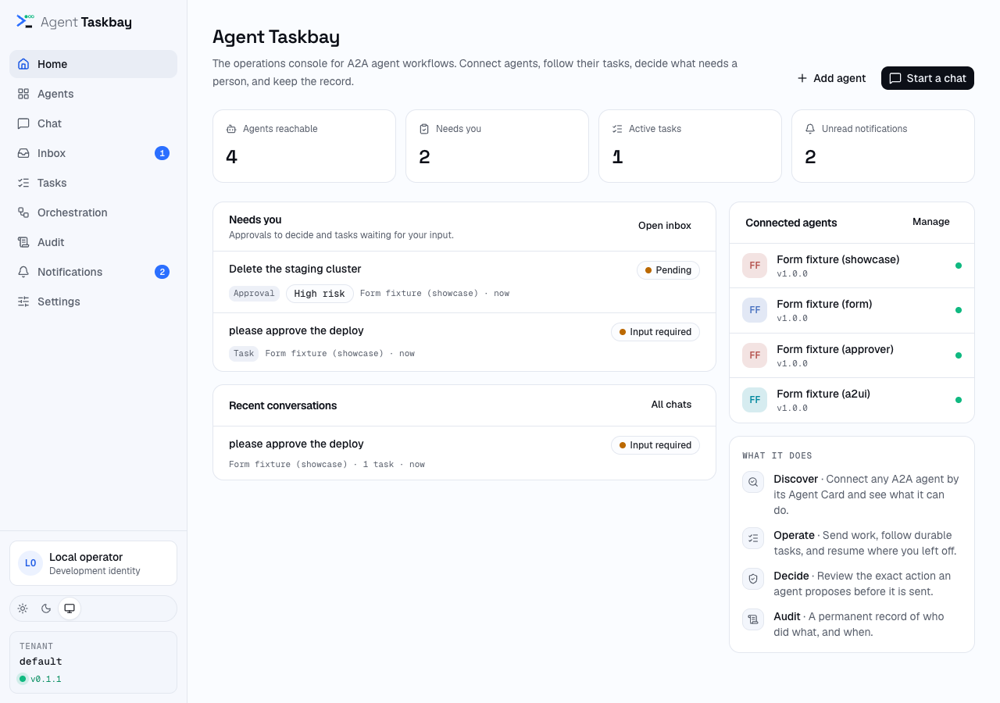
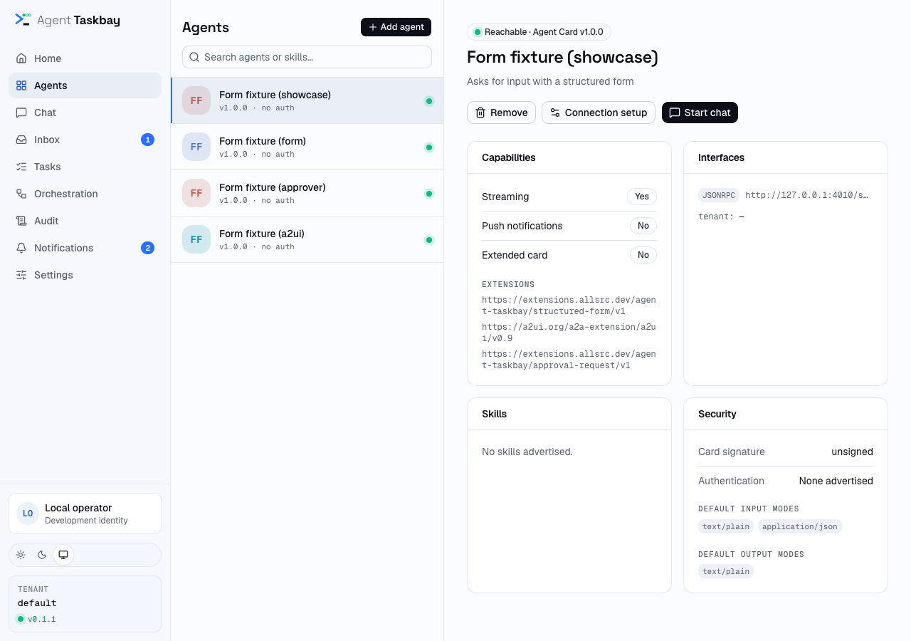
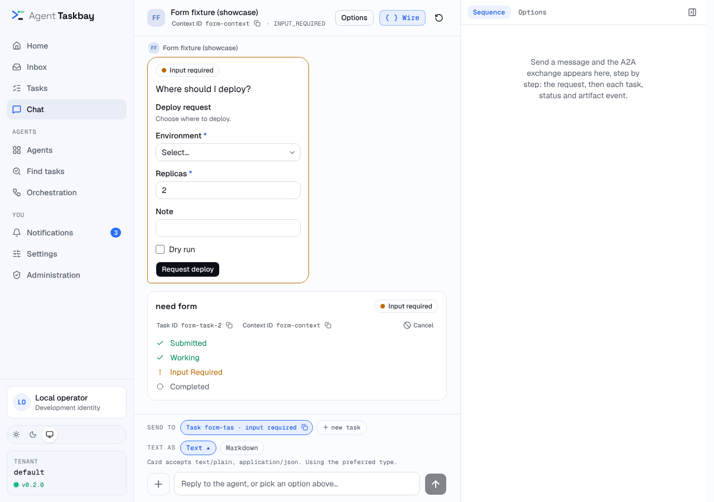
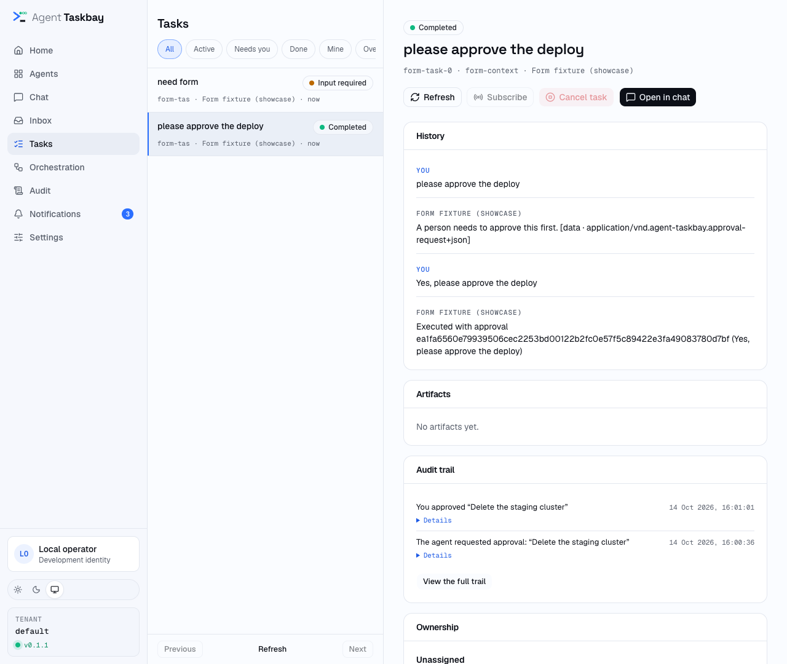
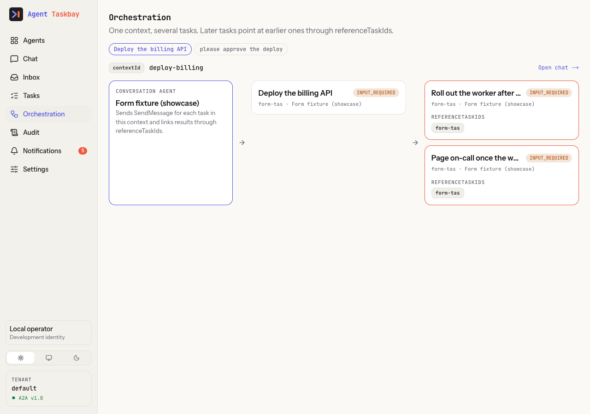
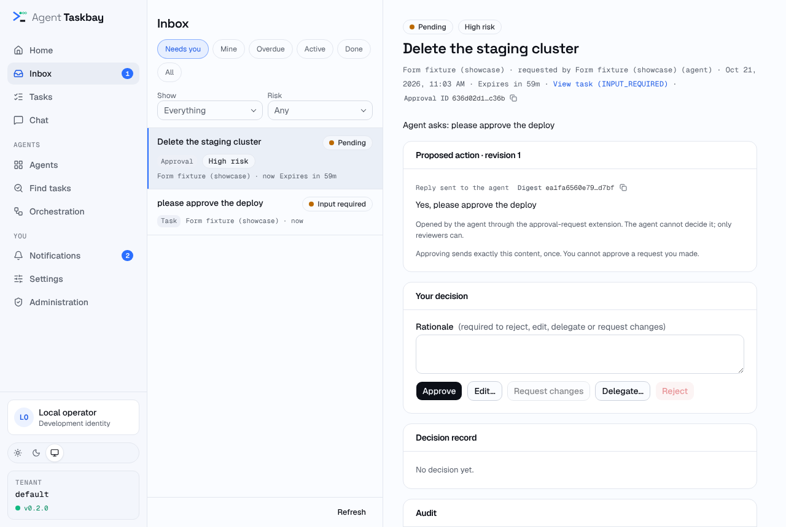
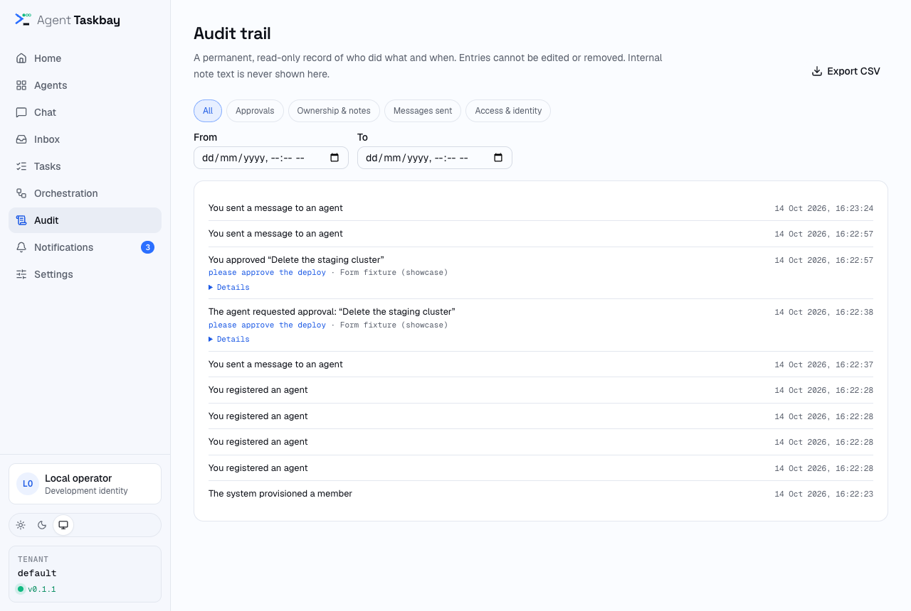

# Use the console: chat, tasks, flows, audit and settings

> Who this is for: anyone who works in the Taskbay console day to day. You will have a map of every screen, know what each control does, and know which actions your role allows.

The console is the web app you open in the browser. The sidebar lists its screens. The server keeps every task, message and artifact, so you can close the tab and come back later. This page walks through each screen in sidebar order. Taskbay is pre-1.0 (version `0.2.0`), so labels and layouts can change between minor versions.

## Before you start

- You are signed in. Locally, `npm run dev` signs you in as a development administrator. See the [Quickstart](../quickstart.md).
- Your role decides what you can do. The console has three roles: **admin**, **operator** and **viewer**. "Reviewer" is not a role. It means an operator or admin who can decide an approval. See [Sign in and roles](sign-in-and-roles.md).
- An operator or viewer also needs a grant for each agent. Without one, that agent and its tasks do not appear at all.
- The UI hides some controls by role, but not all of them. The server always checks. If a button is visible but you lack the right, the action fails with "This action is not permitted."

| Action | admin | operator | viewer |
| --- | --- | --- | --- |
| Read agents, tasks, conversations and notifications | All agents | Granted agents | Granted agents |
| Send messages, answer forms, cancel tasks | Yes | With an "operate" grant | No |
| Add or remove agents | Yes | No | No |
| Organization-wide **Audit**, CSV export | Yes | No | No |
| Read one task's audit trail | Yes | With read access | With read access |
| Admin cards in **Settings** | Yes | Not shown | Not shown |

## The sidebar

On a medium screen the sidebar shrinks to an icon rail; from a large screen it shows labels. The sidebar items are **Home**, **Agents**, **Chat**, **Inbox**, **Tasks**, **Orchestration**, **Audit**, **Notifications** and **Settings**. **Audit** only appears for administrators. On a phone the bottom bar shows **Home**, **Chat**, **Inbox** and **Tasks**, plus a **More** tab that opens a sheet with the rest (**Agents**, **Orchestration**, **Audit** for administrators, **Notifications** and **Settings**), your identity menu and the theme switch. The **Inbox** tab shows a count of pending approvals, and **More** shows a dot when there are unread notifications.

**Inbox** shows a badge with the number of pending approvals. **Notifications** shows your unread count (shown as "99+" above 99). The bottom of the sidebar shows your identity menu, a **Light** / **System** / **Dark** theme switch, the tenant of the first agent that reports one, and the version of Agent Taskbay that is running (the package version, for example `v0.2.0`).

Opening the console root (`/`) takes you to **Chat**.

## Home

**Home** is where the console opens. It shows four counts (agents reachable, items that need you, active tasks and unread notifications), each linking to its screen. **Needs you** lists the approvals and input requests waiting on you, **Recent conversations** lists your latest chats, and **Connected agents** lists the catalog with a reachable or failed dot. With no agent connected yet, Home shows a three-step **Get started** panel instead of **Needs you**.

## Agents

**Agents** lists the agents you can see. A success-coloured dot means the Agent Card was fetched ("Reachable" on hover). A different dot means it failed ("Discovery failed" on hover), and the row shows the error. Use **Search agents or skills…** to filter by name, description, skill name or card URL.

Select an agent to see its card:

- **Capabilities**: streaming, push notifications, extended card, and the advertised extension URIs.
- **Interfaces**: protocol bindings, URL and tenant.
- **Skills**: name and description of each advertised skill.
- **Security**: the card signature result, advertised security schemes, and default input and output modes.

**Start chat** opens a new chat with that agent. It only appears when the card was fetched. **Connection setup** reopens the connect dialog with this card URL. **Remove** appears for agents added in the console, not for agents configured through environment variables, and asks "Remove this agent from the catalog?" first.

**Add agent** opens the "Connect agent" dialog. Every role sees the button, but only administrators can save an agent. The full procedure is in [Connect an agent](connect-an-agent.md).

## Chat

### Start or continue a conversation

**Chat** shows **Start a chat** with one button per reachable agent, and **Recent conversations** below it. If you have no agents, it offers **Add an agent first**.

A conversation is the set of tasks and messages that share one agent, tenant and A2A `contextId`. One conversation can hold many tasks. It is not stored as its own record. The console groups the tasks you can read when it loads them. Each recent conversation shows its title (the start of the first message you sent), the agent, the task count, how long ago it changed and the state of its latest task.

To continue a conversation, open it from **Recent conversations**, from **Open in chat** on a task, or from **Open chat →** in Orchestration. Its URL starts with `/chat/c-`, and you can bookmark it.

The chat header shows the agent, the first 18 characters of the `contextId` ("new conversation" before the first reply) and the latest task state. It has three buttons:

- **Options** opens per-request settings (below).
- **{ } Wire** opens the **Sequence** panel. It lists the A2A requests and events of this browser session, step by step. Select a row to see its JSON. The panel is a diagnostic view of what this tab saw. It is not the stored record and is empty after a reload.
- **Reset** starts a new, empty chat with the same agent.

### Send a message

Type in the box and press Enter, or choose **Send**. Shift+Enter adds a new line. **Text as** switches between **Text** (`text/plain`) and **Markdown** (`text/markdown`). A star marks the type the agent prefers. If the agent's card has a suggested example, the empty chat shows it as a button that fills the box.

Choose **+** (**Add a part**) to add more parts to the same message:

| Menu item | What it sends |
| --- | --- |
| **Upload file** | The file's bytes, base64-encoded, with its name and media type. You can pick several files. |
| **Add file URL** | A URL reference. The console does not fetch it. The agent may. |
| **Add structured data** | A JSON value. It must parse, or you see "Invalid JSON: …". |

Each added part shows as a chip you can remove before sending. The line under **Text as** shows which media types the agent's card accepts. A part outside that list turns amber and says "not in card". The console still sends it, and the agent may reject it.

The whole request, including base64 files, must stay under 16 MB. Larger requests fail with "Request body exceeds the 16 MB limit."

### Pick which task a message goes to

When the conversation has unfinished tasks, a **Send to** row appears above the box. Each chip shows the start of a task ID and its state. The default is the newest task waiting for input or authorization, otherwise the newest unfinished task. **new task** sends inside the same conversation without a task ID, so the agent can open a new task or just reply.

If your access to an agent is limited to one skill, a **Skill** picker appears for new tasks, and each new task starts a new conversation context. See [skill routing](../reference/extensions/skill-routing.md).

### Answer an agent that needs you

When a task is waiting, the agent's message has a coloured border and a label:

- **INPUT_REQUIRED**: the agent asked a question. Reply in the box. The placeholder reads "Reply to the agent, or pick an option above…". If the agent attached a list of `options` or `choices`, they show as buttons that send the chosen text.
- **AUTH_REQUIRED**: the agent needs an authorization the console cannot supply. The bubble says "Complete the authorization the agent asked for, then reply here to resume. In-app credential exchange is not built yet."

If the agent advertises the structured-form extension and sends a form, the bubble shows the form. Fill in the fields (required fields have a star) and choose the agent's submit button. The console checks the values first and shows an error under each invalid field. The values go to the agent as one JSON data part. A form that was already answered, or no longer applies, shows as plain data. If the agent's card defines a start form, a **Start with a form:** section appears above the box while **new task** is selected.

Agents that advertise A2UI can draw a small interface under their messages. Pressing one of its buttons sends your input to the agent. What is and is not rendered is in [Rich content](../concepts/rich-content.md).

An approval is not answered in chat. It appears in **Inbox**. See [Approvals and ownership](approvals-and-ownership.md).

### What you see while a task runs

Your messages sit on the right in a soft blue bubble under a **You** label. The agent's messages, progress, activity and results sit on the left under the agent's name and avatar. The label appears when the speaker changes, so a run of messages from one side shares one label.

Each task has a task card with its title, state, the start of its task ID and context ID, and a step list (for example submitted, working, input required, completed). A new chat becomes its conversation as soon as Taskbay receives the first saved task snapshot, so progress and activity stay visible while a streaming agent works.

While the agent works, its status updates fold into one **Progress** log under the task card. It is open while the task runs and folded once it finishes. Text updates read as lines. Tool calls and results (including ones sent inside a status update) appear as named steps such as `list_directory · call`, and reasoning ("thought") parts as **Reasoning**; each opens to its content, with a raw JSON view. When a sub-agent other than the agent wrote an update (Google ADK `adk_author`), its name appears above that update. Tool calls, results and reasoning sent outside status updates fold into a separate **Activity** log.

When the agent stops working, to ask you something or because the task ended, its last message is the agent speaking to you and stays in the conversation: an **Input required** question with its quick replies or form, the final reply, or the reason a task failed or was rejected. The reply can arrive in any of the ways A2A allows: a direct message, the task history, a status message or a standalone message in the task. Two exceptions keep the conversation clean: a status update the agent sent while still working ("Summarizing…") stays in Progress when a result follows it, and a last message that only repeats a finished text result is shown once. Artifacts appear as a highlighted **Result** card below the task, so the outcome stands out from the progress. A text result reads as prose (Markdown is formatted); other result parts render as tables, trees, media or download cards, following the rules in [Rich content](../concepts/rich-content.md).

### Change the content view

Text can be viewed another way without changing it. Ordinary sentences carry no controls. When text has another useful view, small controls appear under it:

- **Format as Markdown** (or JSON, CSV) when the text looks like that format, and **Plain text** to go back. An agent's Markdown and JSON are formatted from the start, even when the agent labelled them wrongly (for example JSON sent as `text/plain` or `text/html`); your own messages are shown the way you sent them.
- **Preview HTML** for HTML that was declared or detected. HTML is never rendered by default: the text view shows its source in a contained code block.
- **⋯** opens a menu with the type the sender declared ("Sent as text/plain") and every view: Auto, Text, Markdown, JSON (when valid), CSV (when applicable) and **Sanitized HTML**.

**Preview HTML** opens an isolated iframe in a dialog on desktop or a sheet on phones. Inline sanitized HTML strips styles; the rich preview retains CSS inside the iframe. Neither view runs scripts or loads remote resources; links, forms and embedded active content are removed. Viewing choices are local to that message and reset when it is remounted. They never edit the stored content, its media type, or anything sent to an agent.

**Cancel** on the task card appears while the task is active. It asks "Cancel this task?" and then asks the agent to cancel. A toast says "Task canceled" on success. The agent decides whether it can cancel.

### Per-request options

**Options** shows the A2A send configuration for this chat:

| Option | Effect |
| --- | --- |
| **returnImmediately** | Ask the agent to return the task as soon as it exists instead of waiting. Starts on for agents whose card advertises streaming; otherwise starts from your **Settings** value. Taskbay then follows active tasks over the agent's stream. |
| **historyLength** | How many history messages the agent returns. Empty means no limit. Starts from your **Settings** value. |
| **acceptedOutputModes** | Media types you accept. Starts from the agent card's output modes, or your **Settings** defaults if the card declares none. A star marks modes the card declares. |
| **referenceTaskIds** | Earlier tasks in this conversation that the next message builds on. Cleared after each send. |

These options stay for the chat you have open. They are not saved.

## Tasks

**Tasks** lists the tasks you can read, newest first, 50 per page, with **Previous**, **Refresh** and **Next**. Filters: **All**, **Active**, **Needs you**, **Done**, **Mine**, **Overdue** and **Unassigned**. Each row shows the title, state, short task ID, agent and last change. It also shows the assignee, the due time and "escalated" when they apply.

Open a task to see its detail page. The header shows the title, state, full task ID, context ID and agent. The buttons are:

- **Refresh** reloads the task.
- **Open in chat** opens the conversation the task belongs to.
- **SubscribeToTask** asks the server for the task's latest state from the agent's stream. It only works while the task is active and the agent supports it.
- **CancelTask** asks the agent to cancel, after the same "Cancel this task?" prompt.

The cards are:

| Card | Shows |
| --- | --- |
| **Ownership** | Assignee, due time, escalation, recent ownership events. See [Approvals and ownership](approvals-and-ownership.md#own-a-task). |
| **Status timeline** | Each state the task passed through, with its time |
| **History** | Messages in order, labelled USER or AGENT. Non-text parts show as `[kind · media type]`. |
| **Artifacts** | Each artifact's name and media type. **Download** appears for files the server archived. "No artifacts yet." otherwise. |
| **Approvals** | Approvals for this task, and **Request approval** while the task is active |
| **Internal notes** | Team notes, never sent to the agent |
| **Audit trail** | The latest 8 entries for this task, and **View the full trail** |
| **Identifiers** | `localId` (the console's own ID, used in URLs), `taskId`, `tenant`, `contextId`, the number of messages (`messageIds`), the artifact IDs, and any `referenceTaskIds`. A reference links to the other task when the console knows it. |

The remote IDs come from the agent and are for diagnosis. The console uses `localId` for links and permission checks. See [Durable tasks](../concepts/durable-tasks.md#identity-of-remote-ids).

## Orchestration (Flows)

**Orchestration** (the **Flows** item on small screens, URL `/flows`) is a read-only picture of one conversation. It does not define, run or schedule workflows.

It shows conversations that contain at least one task. With several, a row of tabs lets you pick one. The default is the conversation with the most tasks. For the chosen conversation it shows:

- the `contextId` and **Open chat →**,
- a **Conversation agent** box naming the agent,
- one card per task. A task that lists other tasks of the same conversation in its `referenceTaskIds` sits in a second column with those IDs on the card.

The arrows are only a layout. They show references the agent or you set, not an execution order the console enforces. References to tasks outside the conversation are not drawn. Each card links to its task. The console has no link between tasks of different agents yet.

## Inbox and Notifications

**Inbox** gathers tasks waiting for a person and open approvals in one list. Approving, claiming, assigning and escalation are covered in [Approvals and ownership](approvals-and-ownership.md).

**Notifications** lists your own notifications, newest first, 30 at a time, with **All** and **Unread** tabs, **Mark all read** and **Show older notifications**. Unread items have a dot. Items that need you, such as a new approval or a task waiting for input, carry an "ACTION" tag until read. Opening one marks it read and goes to the task or approval. Read marks are stored on the server, so they follow you across browsers. What triggers a notification, and the optional webhook, are in [Notifications](notifications.md).

## Audit

**Audit** is the organization-wide audit trail. Only administrators see it in the sidebar. A non-admin who opens `/audit` sees "Administrators only".

The trail is read-only and newest first, 25 entries at a time with **Show older entries**. Each entry is one sentence ("You approved …", "The agent requested approval: …"), a time, and a link to the task. **Details** expands the exact facts: revision and digest, proposed or sent content, rationale, risk, expiry and delivery result. Note text is never shown, only that a note was added.

Filters:

- Group tabs: **All**, **Approvals**, **Ownership & notes**, **Messages sent** and **Access & identity**.
- **From** and **To** limit the time range.

**Export CSV** downloads up to 200 rows of the current filter as `audit-trail.csv`. It is for administrators only.

Anyone who can read a task can see that task's trail through **View the full trail** on the task page. That view is titled "Task audit trail", has **Back to task**, and offers only the **All**, **Approvals** and **Ownership & notes** tabs to non-admins.

## Settings

**Settings** mixes two kinds of setting. Know which kind you are changing.

### Saved in this browser

**Request defaults** and **Extensions** are stored in your browser's local storage (key `agent-taskbay.settings`). They apply only to chats you open in this browser. They are not saved on the server, not shared with other people, and not recorded in the audit trail. Every role can change them.

| Card | Setting | Effect |
| --- | --- | --- |
| **Request defaults** | **Plain text**, **Markdown**, **Structured data**, **PDF files** | The `acceptedOutputModes` used when an agent card declares none. The first three are on by default. |
| | **Return immediately** | Default for agents that do not advertise streaming. Streaming-capable agents start with the option on; the per-chat switch overrides it. Off by default. |
| | **Push notifications** | Always off and disabled. It does nothing. Push from agents into Taskbay is set on the server; see [Receive push callbacks from agents](agent-push-callbacks.md). |
| | **historyLength** | Default for the chat option. Empty means unset. |
| **Extensions** | Extension URIs, **Add**, toggle, **Remove extension** | URIs you activate on every message you send, in addition to the extensions the console activates itself |

### Organization settings (administrators only)

These cards load from the server. If you are not an administrator, the server answers 403 and the cards do not appear. Changes apply to the whole organization.

| Card | What an administrator can do |
| --- | --- |
| **Teams and access** | **Create team**, **Add member**, **Remove** a member, **Grant access** (to everyone, a member or a team, for a whole agent or one skill, with Read or Read and operate), and **Revoke**. See [Give people access to agents and skills](teams-and-grants.md). |
| **Agent credentials** | See whether each agent has a credential and its kind ("configured", "revoked" or "unconfigured"). Secrets are set with a CLI on the server and never shown. See [Agent credentials](agent-credentials.md). |
| **Escalation** | Add a rule (**Applies to**, **Escalate to**, **Save rule**) and **Turn off** or **Turn on** a rule. See [Approvals and ownership](approvals-and-ownership.md#escalation). |
| **Notification channel** | See whether the webhook is configured, how many deliveries succeeded, are waiting, or gave up, the last failure, and **Send test notification**. The URL and secret live in server configuration. See [Notifications](notifications.md). |

## When it fails

| Symptom | Likely cause | What to do |
| --- | --- | --- |
| "This action is not permitted." when sending, cancelling or adding an agent | Your role or grants do not allow it. Viewers never send. | Ask an administrator for an "operate" grant or a different role |
| The message box is greyed out | The agent's card is still loading. The console waits for it because extensions depend on it. | Wait. If it stays disabled, check the agent on **Agents**. |
| "Durable task stream unavailable; query task or command status before retrying." | The command failed or has an uncertain outcome, or the live view broke | Open the task under **Tasks** and check its state before sending again. The console never resends on its own. See [Durable tasks](../concepts/durable-tasks.md#uncertain-outcomes). |
| "Request body exceeds the 16 MB limit." | Attached files are too large once base64-encoded | Send smaller files, or a URL part |
| "Enter a full URL, including https://" | The file URL is not a full URL | Include the scheme |
| "Invalid JSON: …" | The structured data part does not parse | Fix the JSON |
| A form shows as raw data | The agent does not advertise the extension, the form is outside the supported subset, or it was already answered | See [Rich content](../concepts/rich-content.md#when-it-fails) |
| "Conversation not found" / "This conversation is unavailable in the current organization." | The link is from another organization, or you lost read access | Open the chat from **Recent conversations**, or ask for a grant |
| "Task not found" | The task does not exist or you cannot read it. The server answers 404 rather than 403. | Ask an administrator for a grant |
| Banner ending "Retrying server sync…" | The browser could not load tasks from the server | Check the server is running. The console retries every 5 seconds. |
| "Administrators only" on **Audit** | You are not an administrator | Open a task and use **View the full trail** |
| Admin cards missing in **Settings** | You are not an administrator | Ask an administrator |
| "Too many requests. Try again shortly." | Per-person rate limit | Wait a minute |

More symptoms are in [Troubleshooting](../operations/troubleshooting.md).

## Limits

- Pre-1.0: labels, layouts and URLs can change.
- These screens are not covered by browser end-to-end tests. The structured-form and A2UI renderers have component tests, and the routes behind the screens are exercised by `npm run test:http`.
- Conversations and the Orchestration view are built in your browser from the tasks it loads. The browser loads every task you can read, so very large task lists make them slow.
- The **{ } Wire** panel and the chat options are per tab and are lost on reload.
- Browser-stored settings do not follow you to another browser or device.
- The UI hides some controls by role but not all. The server enforces every permission.
- No free-text search over tasks or conversations, and no saved views ([#5](https://github.com/allsrc/agent-taskbay/issues/5)).

## Related

- [Quickstart](../quickstart.md): run the console and send a first task.
- [Approvals and ownership](approvals-and-ownership.md): the Inbox, approvals, claiming and escalation.
- [Notifications](notifications.md): what triggers a notification and the webhook.
- [Rich content](../concepts/rich-content.md): how messages, files, forms and A2UI render.
- [Give people access to agents and skills](teams-and-grants.md): teams and grants in **Settings**.
