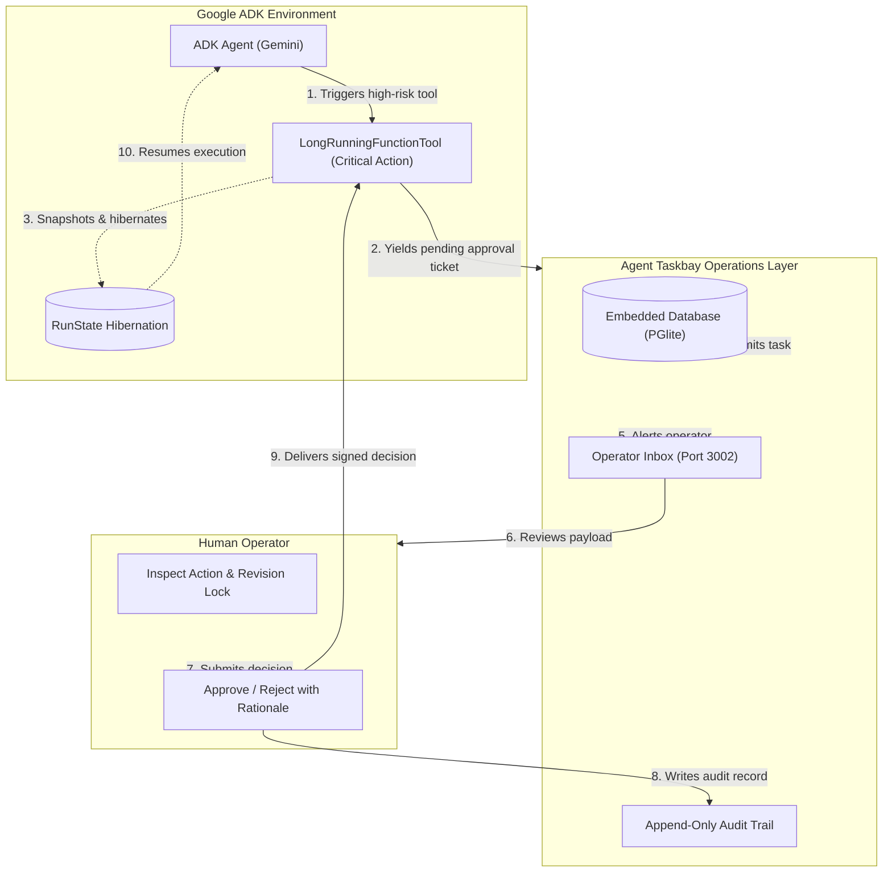

# Google Agent Development Kit (ADK) + Agent Taskbay: Human-in-the-Loop Integration

This example demonstrates how to integrate **Google Agent Development Kit (ADK)** with **Agent Taskbay** for durable, production-grade Human-in-the-Loop (HITL) operations.

## The Architectural Story: Bridging ADK Hibernation & Human Operations

Google's Agent Development Kit (ADK) treats human oversight as a foundational primitive through three core features:
1. **Human Input Nodes (`RequestInput`)**: Deterministic workflow checkpoints that pause for human feedback without burning LLM inference tokens.
2. **Tool-Level Approvals (`require_confirmation=True` / `LongRunningFunctionTool`)**: Sensitive tools (such as database migrations, financial transactions, or infrastructure changes) yield an asynchronous `pending` ticket.
3. **RunState Persistence**: When an agent hits an approval gate, it snapshots its execution state into storage and hibernates—consuming zero active CPU or memory while waiting for human sign-off.

### The Missing Piece in ADK
While ADK solves the **agent-side state hibernation**, it leaves the **human operational surface** unsolved. In standard ADK setups, developers typically resort to:
- Polling in local terminal CLI prompts (which dies if the terminal closes).
- Ad-hoc Telegram, Slack, or Discord bots (which lack tamper-evident revision locks and enterprise audit trails).
- Bespoke Streamlit or Retool dashboards (which require high engineering overhead for every new tool schema).

### How Taskbay Completes the ADK Workflow
Agent Taskbay is the dedicated human operations layer for ADK agents:
- **Durable Inbox**: When an ADK tool flags `require_confirmation=True` or returns a `LongRunningFunctionTool` pending state, it registers an A2A task with Taskbay.
- **Embedded Database Durability**: Taskbay records the task in its embedded database (`~/.agent-taskbay/pglite`). If the operator takes 10 minutes or 3 days, the state remains intact.
- **Exact Revision Locking**: Approvals in Taskbay are locked to the exact action payload. If parameters change or expire, stale decisions are rejected.
- **Multi-Modal Inspection**: Operators inspect SQL diffs, JSON payloads, Markdown reports, and media artifacts in a sandboxed, security-hardened UI before approving.
- **Append-Only Audit Log**: Every approval, rejection, and rationale is recorded permanently for compliance.

---

## Architectural Flow



---

## Running the Example

### 1. Install Dependencies
```bash
pip install -r requirements.txt
```

### 2. Start Taskbay Console (in another terminal)
```bash
npx agent-taskbay
```
The console will start at `http://127.0.0.1:3002`.

### 3. Run the ADK Agent
```bash
python adk_agent.py
```

### 4. Approve in Taskbay
1. Open the Taskbay console at `http://127.0.0.1:3002`.
2. Look at the **Inbox** under **Needs you**.
3. Inspect the pending action: `"Scale Production Kubernetes Cluster"`.
4. Click **Approve**.
5. Watch the ADK agent wake from hibernation and complete the execution!
