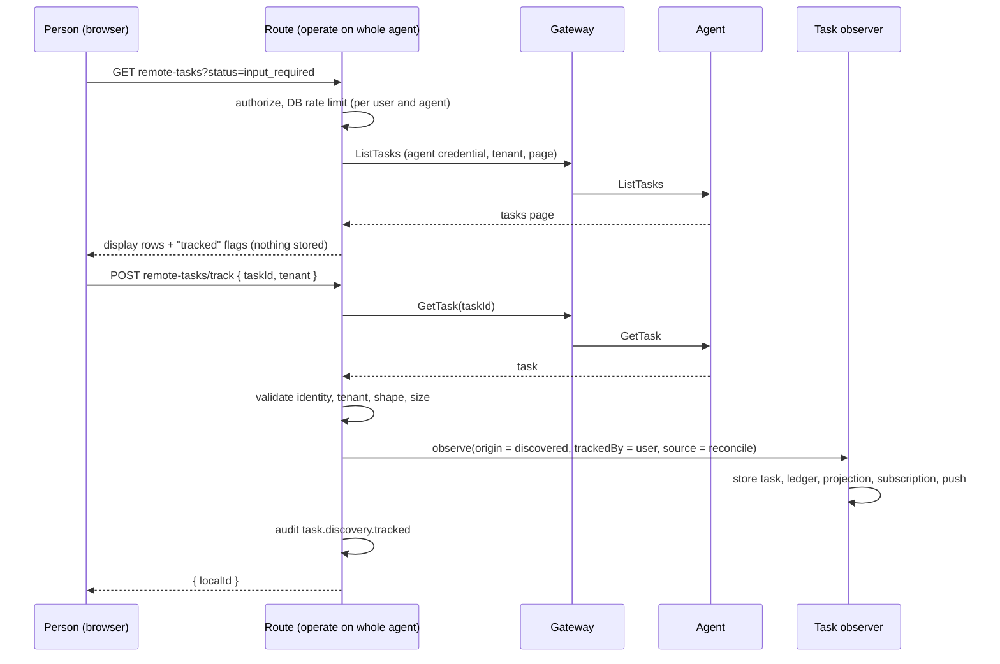
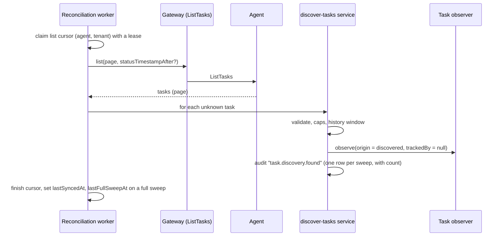
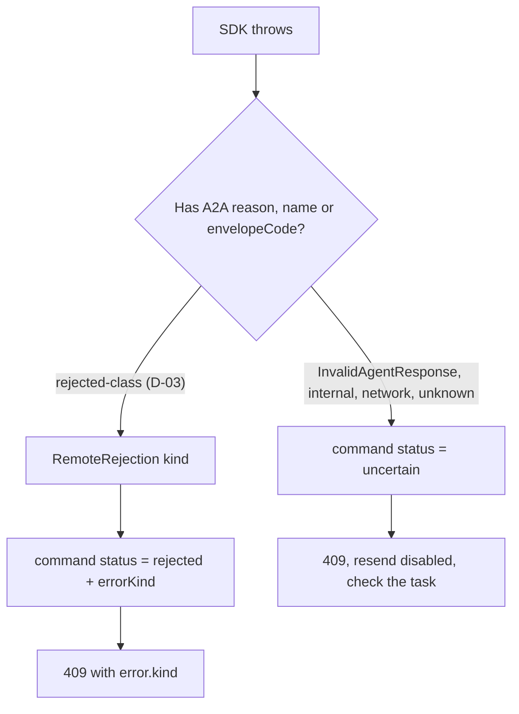

# Architecture changes

> Who this is for: anyone implementing a task. You will know where things live today, what changes in each layer, the order of data model changes, and the security rules that apply.

Paths are relative to the repository root. Verified against `main` at `a52de4c`. If a file has moved, the code wins; tell the maintainer in your task's Notes for later.

## Layering

The existing boundaries stay ([Development setup](../../docs/contributing/development.md#boundaries)).

```text
src/app/api/**            HTTP routes: validate input, authenticate, call a runtime function
src/server/runtime/**     wiring per request or per job: builds services with adapters and a transaction
src/server/application/   services (use cases) and ports (interfaces); no React, Next.js or MikroORM
src/server/domain/**      records and rules
src/server/adapters/**    db (MikroORM), a2a (SDK), auth, blob, live, notify, agui
src/server/workers/**     loops that call services
src/lib/gateway.ts        the only file that talks to @a2a-js/sdk for operations
```

## Codebase map for this plan

| Concern | Where |
| --- | --- |
| SDK boundary: discovery, `executeOperation`, `streamOperation`, error wrapper | `src/lib/gateway.ts` |
| Command intent: validation, idempotency, outbox row | `src/server/runtime/commands.ts` (`acceptCommandWithin`), `application/services/task-command.ts` |
| Command dispatch: lease, send, outcome states `succeeded` / `failed` / `uncertain` | `application/services/dispatch-command.ts`, `adapters/a2a/command-gateway.ts` |
| Observing events into the ledger and the task row | `application/services/observe-task.ts` (`ObserveTaskService`), `runtime/task-persistence.ts` (`createTaskObserver`) |
| Projection (messages, artifacts, state) | `application/services/versioned-task-projection.ts`, `task-projection.ts` |
| Reconciliation: `GetTask` per open task, `ListTasks` sweep | `application/services/reconcile-task.ts`, `adapters/a2a/reconciliation-gateway.ts`, `runtime/reconciliation.ts`, `workers/reconciliation-loop.ts`, `adapters/db/sync-repository.ts` |
| Streams and push | `application/services/observe-subscription.ts`, `push-lifecycle.ts`, `receive-push.ts`, `adapters/a2a/*-gateway.ts`, `app/api/webhooks/a2a/[registrationId]/route.ts` |
| Access control | `application/services/access-policy.ts`, `adapters/db/security-repository.ts` (`taskAccessFilter`) |
| Entities and repositories | `adapters/db/entities.ts`, `adapters/db/repositories.ts`, migrations in `adapters/db/migrations/`, `adapters/db/schema-version.ts` |
| Task list/detail queries | `application/services/task-query.ts`, `app/api/tasks/route.ts`, `app/api/tasks/[taskId]/route.ts` |
| Notifications and inbox | `application/services/notification-fanout.ts`, `inbox-query.ts`, `adapters/db/inbox-repository.ts` |
| Chat | `components/chat/chat-view.tsx`, `timeline.tsx`, `composer.tsx`, `lib/conversations.ts`, `lib/run-message.ts` |
| Task and agent screens | `app/tasks/layout.tsx` (list), `app/tasks/[taskId]/page.tsx`, `app/agents/[agentId]/page.tsx`, `components/agents/connect-agent-dialog.tsx` |
| State vocabulary and tones | `lib/task-view.ts`, `components/a2a/primitives.tsx` |
| Fixture agents and HTTP verification | `scripts/fixture-*.mjs`, `scripts/verify-*-http.mjs` |

Facts to rely on (each was read in the code):

- `acceptCommand` always sends `returnImmediately: true` unless the caller's `config` overrides it.
- A list sweep cursor (`resource_key = ""`) is created per `(agent, tenant)` **only when a task for that pair is first stored** (`sync-repository.ts`). A brand-new agent has no cursor, so discovery needs its own seeding (T-08).
- `ReconciliationWorker` ignores any listed task it does not already know (`known.get(...)` then skip). Discovery changes exactly this.
- `waitForCommand` maps `failed` and `uncertain` to `409` with the stored `lastError`.
- `observationPaused` stops subscribing on terminal states **and** on `INPUT_REQUIRED` / `AUTH_REQUIRED` / `MESSAGE_ONLY`; the 15 s `GetTask` cursor covers those.
- `ObserveTaskService.observe` creates the task row (`getOrCreate`) when the event carries a remote task ID, so a discovery sink can reuse it.
- `taskAccessFilter`: admins and policy-less requests see everything; others match `{agentId}` for whole-agent grants and `{agentId, skillId}` for skill grants.

## Changes by layer

### Domain and ports (`src/server/domain`, `src/server/application/ports`)

| Change | Task |
| --- | --- |
| `CommandStatus` adds `"rejected"` (a definite refusal by the agent). `TaskCommandRecord.lastError` keeps a short fixed message; add `errorKind: RemoteErrorKind \| null` | T-03 |
| New port file `ports/remote-errors.ts`: `RemoteErrorKind`, `RemoteRejection` (extends `Error`, has `kind`, `code`) | T-03 |
| `TaskRecord` adds `origin: "created" \| "discovered"`, `discoveredAt: Date \| null`, `trackedByUserId: string \| null` (null when found by automatic discovery) | T-07 |
| `AgentRecord` adds `extensionOverride: boolean` (T-06) and `taskDiscovery: "off" \| "browse" \| "auto"` (default `browse`), `taskDiscoveryHistoryDays: number`, `taskDiscoveryPausedReason: string \| null` (the last two apply to `auto`) | T-07 |
| `SyncCursorRecord` adds `lastFullSweepAt: Date \| null` | T-07 |
| Reconciliation port: `list(...)` accepts `{ statusTimestampAfter?, historyLength?, tenant }` (T-08); new sink method `discover(cursor, event)` (T-25) | T-08, T-25 |
| `TaskLinkRecord { id, organizationId, fromTaskId, toTaskId, kind: "references", createdAt }` and a `TaskLinkRepository` | T-19 |
| `AgentCardSnapshotRecord` adds `kind: "public" \| "extended"` | T-17 |

### Services (`src/server/application/services`)

| New or changed | Task |
| --- | --- |
| `dispatch-command.ts`: catch `RemoteRejection` and settle `rejected` with the error kind; keep `uncertain` otherwise | T-03 |
| `task-command.ts` / `commands.ts`: refuse terminal-task sends and cancels with `409 TASK_TERMINAL` after one fresh read | T-05 |
| `agent-catalog.ts` / discovery: compute `requiredExtensions` and `unsupportedRequired`; `acceptCommandWithin` refuses sends when non-empty unless an admin override is set | T-06 |
| New `browse-agent-tasks.ts` (live list, no storage) and `track-task.ts` (`GetTask`, validate, observe with `origin = "discovered"`, `trackedByUserId`, audit) | T-08 |
| New `discover-tasks.ts` (automatic mode): validates listed tasks, applies caps and the history window, observes with `origin = "discovered"`, writes audit rows | T-25 |
| `observe-task.ts`: no first-sight notification for tracked tasks; D-13 rules for automatic ones; stamp `origin` | T-09 |
| `task-query.ts`: filters (`contextId`, `agentId`, `updatedAfter`, `origin`, `after` cursor); `steering` outcomes on detail; `related` links | T-13, T-15, T-19 |
| New `fetch-extended-card.ts` | T-17 |
| New `task-links.ts` (derive and read) | T-19 |

### Adapters

| Change | Task |
| --- | --- |
| `adapters/a2a/command-gateway.ts`: map SDK errors to `RemoteRejection` (using `reason`, then `name`, then `envelopeCode`) | T-03 |
| `lib/gateway.ts` protected wrapper keeps `reason` and `statusCode` | T-03 |
| `adapters/a2a/reconciliation-gateway.ts`: pass new list parameters | T-08 |
| `adapters/db/*`: entities, repositories and one migration per schema-changing task | T-03, T-06, T-07, T-17, T-19 |
| `adapters/a2a/push-gateway.ts`: `listPushConfigs`; `receive-push.ts`: signed-notification verification | T-21 |

### Runtime, routes and workers

| Change | Task |
| --- | --- |
| `workers/reconciliation-loop.ts`: no new loop. In mode `auto`, `ReconciliationWorker` handles discovery cursors; a startup/after-discovery step ensures list cursors exist per `(agent, tenant)` for `auto` agents only | T-25 |
| `runtime/reconciliation.ts`: `discover` sink next to `ingest` | T-08 |

New and changed HTTP surface (document each in `docs/reference/http-api.md`):

| Route | Change | Task |
| --- | --- | --- |
| `POST /api/agents/:id/messages`, `/commands`, `/stream`, `…/cancel` | Error bodies gain `error.kind`; `409 TASK_TERMINAL`; `409 EXTENSION_REQUIRED` | T-03 to T-06 |
| `GET /api/commands/:id` | `status` may be `rejected`; `errorKind` | T-03 |
| `PATCH /api/agents/:id/settings` (admin) | `{ taskDiscovery: off\|browse\|auto, taskDiscoveryHistoryDays }`, `{ extensionOverride }` | T-06, T-10 |
| `GET /api/agents/:id/discovery` | Mode, deployment cap, and for `auto`: last sweep, counts, paused reason | T-10 |
| `GET /api/agents/:id/remote-tasks` | Live browse: `tenant`, `contextId`, `status`, `pageToken`; returns display rows with `tracked` flags; nothing stored | T-08 |
| `POST /api/agents/:id/remote-tasks/track` | `{ taskId, tenant }`; re-reads the task and stores it | T-08 |
| `GET /api/tasks` | New query params `contextId`, `agentId`, `updatedAfter`, `origin`, `after` | T-13 |
| `GET /api/tasks/:id` | Adds `origin`, `steering`, `related`, `contextSiblings` | T-11, T-14, T-15, T-19 |
| `POST /api/agents/:id/extended-card/refresh` (admin) | Fetch and store the extended card | T-17 |
| `POST /api/tasks/:id/history/refresh` | Fetch remote history | T-22 |

### UI

See [UI-DESIGN.md](UI-DESIGN.md). New components stay next to their feature; no new design-system primitives unless a task says so.

## Data model changes, in migration order

Only `Migration0001_Baseline` exists. The order below is indicative: each task takes the next free number when it starts (D-09), and the tracker refuses to start two migration tasks at once. `DB_SCHEMA_VERSION` is raised in the same change.

| Order | Task | Change |
| --- | --- | --- |
| 1 | T-03 | `task_commands.error_kind` nullable string (length 64). Also extend a check constraint on `status` if the baseline has one. |
| 2 | T-06 | `agents.extension_override` boolean not null default false |
| 3 | T-07 | `tasks.origin` text not null default `'created'`; `tasks.discovered_at` timestamptz null; `tasks.tracked_by_user_id` uuid null; `agents.task_discovery` text not null default `'browse'`; `agents.task_discovery_history_days` int not null default 7; `agents.task_discovery_paused_reason` text null; `sync_cursors.last_full_sweep_at` timestamptz null; index `(organization_id, agent_id, origin)` on `tasks`. Existing rows get the defaults (`browse`). Every new column is nullable or has a default, so an older running instance keeps working against the new schema. |
| 4 | T-25 | `sync_cursors.sweep_started_at` timestamptz null, `sweep_found` int not null default 0, `sweep_after` timestamptz null (progress of an automatic sweep, so any worker can continue it) |
| 5 | T-17 | `agent_card_snapshots.kind` text not null default `'public'` |
| 6 | T-19 | New table `task_links(id, organization_id, from_task_id, to_task_id, kind, created_at)`, unique `(from_task_id, to_task_id, kind)`, index on `to_task_id` |

Each also updates `docs/reference/data-model.md`, and the baseline-to-latest upgrade must pass `npm run db:migrate` and `npm run db:schema:check` on PGlite and PostgreSQL.

## Discovery flows (T-07 to T-12, T-25, T-26)

### Browse and track (default mode)



Rules: browse results are never persisted or cached. The server re-reads the task on Track and ignores any content from the browser (D-15). A task already stored is returned as is. A terminal task can be tracked (read-only history), and gets no subscription.

### Automatic sweep (mode `auto`, opt-in)



Rules:

1. Known tasks keep the existing path (`ingest`). Unknown tasks go to `discover`.
2. Unknown terminal tasks older than the history window are skipped and not counted.
3. Newly stored non-terminal tasks get a subscription row and a push registration like any other (existing `subscriptions.sync` and push `adopt`). Add a test that they do.
4. List cursors are created only for `auto` agents, for tenants `{""} ∪ {supportedInterfaces[].tenant} ∪ {tenants of known tasks}`. Leaving `auto` sets them `stopped`; entering it resets them to `pending`.
5. If `taskDiscoveryPausedReason` is set (cap reached), the sweep still refreshes known tasks but skips discovery.
6. Cursors use leases, so several workers or instances can share the load without double work (existing `PESSIMISTIC_PARTIAL_WRITE` claim).

## Command failure flow (T-03 to T-05)



## Hosting profiles

Durable storage is the product: every command, event and decision is in the database, and workers recover from leases. This section makes the three ways of running it explicit so no task breaks one of them (D-16).

| Profile | How it runs | Database | Workers | People |
| --- | --- | --- | --- | --- |
| **Dev** | `npm run dev`, `npx agent-taskbay` | Embedded PGlite under `.data/` or `~/.agent-taskbay`; one process owns it | Embedded in the server process | Local administrator, loopback only |
| **Self-hosted** | `npm start` or a container | PostgreSQL | Embedded, or `npm run worker:tasks` processes | OIDC recommended; roles and grants |
| **Enterprise / SaaS** | Several app instances and worker processes behind a load balancer | PostgreSQL | Separate worker processes, scaled independently | OIDC, many organizations, grants per agent and skill |

Rules every task follows:

1. **No process memory as state.** Anything another instance must see (rate limits, cursors, cached cards, discovery progress) is in the database. Per-request objects are fine. Browse results are request-scoped only.
2. **Safe with N instances.** Background work is claimed with leases (`outbox`, `sync_cursors`, subscriptions, push). New workers or services reuse those claims; never "run on the instance that received the click".
3. **Organization scoping.** Every new table has `organization_id`; every query filters by it and by the caller's grants. Tests include two organizations.
4. **Rolling upgrades.** New columns are nullable or defaulted; new enum-like values are accepted by old code or only written after the new code is everywhere. A task that cannot be rolled safely says so and documents the order (migrate, then deploy workers, then app).
5. **Dev stays one command.** Nothing may require a second process, a queue, a cache server or an environment variable to try the product. Defaults work with `npx agent-taskbay`; the sample agent from `npx agent-taskbay demo-agent` must let a new user try every user-facing feature in this plan (T-27).
6. **Both databases in CI.** DB tests run on PGlite and, when `A2A_TEST_POSTGRES_URL` is set, on PostgreSQL. Avoid SQL that only one supports. PGlite is single-process: `A2A_DATABASE_PROFILE` rules in `docs/guides/production-deployment.md` still apply.
7. **Separate workers.** Anything a worker does must also work with the worker in a different process (`scripts/command-worker.ts`). Add the new job to that entry point when relevant and cover it in the worker HTTP check.
8. **Operators can see and control it.** New background behavior has an off switch, a visible status, an audit entry and a troubleshooting row.
9. **Data protection.** Prefer not storing. Where data is stored, it follows the existing ledger and artifact rules; retention is tracked as a known limit (D-10).

## Security rules for this plan

Update `docs/security/threat-model.md` in the tasks marked below.

| Rule | Task |
| --- | --- |
| Browse and track need operate on the whole agent; discovered tasks respect `taskAccessFilter`; skill-scoped principals never see them; regression tests | T-02, T-08 |
| Browse is rate limited with the database-backed limiter (works across instances) and never persists results | T-08 |
| Track re-reads the task server-side; browser-supplied content is ignored | T-08 |
| Discovery uses only the agent's bound credential; automatic mode stores only `ListTasks` results that pass validation | T-08, T-25 |
| A listed task is validated like a reconciled one: identity, tenant, status shape, size limits; a hostile list cannot create more than the caps | T-08, T-25 |
| Remote error text is shown as quoted data and never as UI copy; only `kind` selects copy | T-03, T-04 |
| An unsupported required extension blocks sends; the admin override is audited | T-06 |
| Extended card passes the same checks as the public card (`assertSafeAgentCard`, 2 MiB limit, signature check) and never changes skill routing or grants unless an admin opts in | T-17 |
| JWT/JWKS fetches use the safe fetch (no redirects, private ranges blocked, origin allowlist), cache keys, `alg` allowlist, clock-skew limit | T-21 |
| Cancel-related never cancels a task the person cannot operate | T-20 |
| No new stored secrets. Nothing in this plan stores or forwards credentials | all |

## Configuration added

| Variable | Default | Meaning | Task |
| --- | --- | --- | --- |
| `A2A_TASK_DISCOVERY` | `browse` | Highest discovery mode any agent may use: `off`, `browse` or `auto` | T-07 (read), T-10 (enforced in UI and API) |

Document in `docs/reference/configuration.md` and `docs/guides/configuration-recipes.md`. No other new variables.

## Audit event names

`task.discovery.mode_changed` (old, new), `task.discovery.tracked` (task id, who), `task.discovery.found` (automatic; count, no task content), `task.discovery.paused`, `agent.extension.override`, `task.cancel.related`. Existing events keep their names. Add them to the audit documentation page that lists events (find it with `grep -rn "task.send.accepted" docs/`).

## Related

- [DECISIONS.md](DECISIONS.md)
- [UI-DESIGN.md](UI-DESIGN.md)
- [README.md](README.md)
